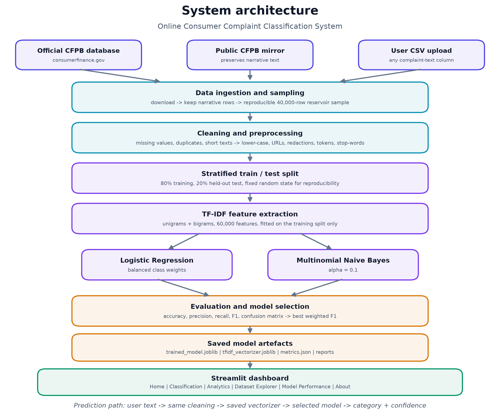
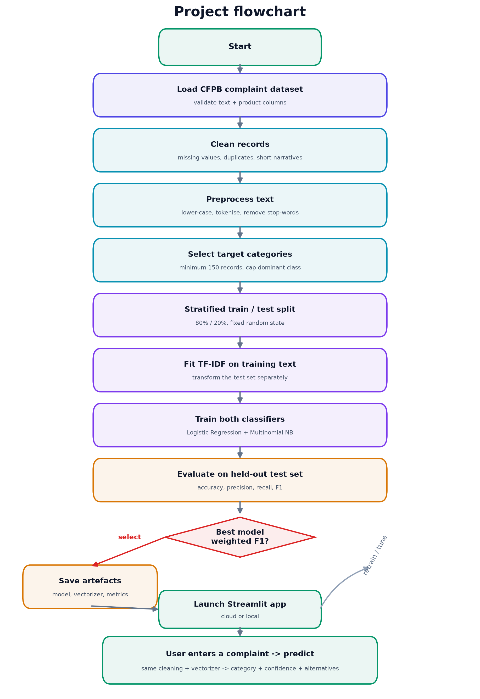

# Online Consumer Complaint Classification System

### A Web Data Mining Mini-Project Report

**Domain:** Web Data Mining / Text Classification
**Stack:** Python · Streamlit · scikit-learn · TF-IDF · Logistic Regression · Multinomial Naive Bayes · Plotly
**Dataset:** CFPB Consumer Complaint Database (real public data)
**Date of build:** November 2026

---

## Table of contents

1. [Abstract](#1-abstract)
2. [Introduction](#2-introduction)
3. [Problem statement](#3-problem-statement)
4. [Objectives](#4-objectives)
5. [Scope and deliverables](#5-scope-and-deliverables)
6. [Background and related concepts](#6-background-and-related-concepts)
7. [Dataset description](#7-dataset-description)
8. [Dataset provenance and limitation](#8-dataset-provenance-and-limitation)
9. [Data collection methodology](#9-data-collection-methodology)
10. [Data cleaning and preprocessing](#10-data-cleaning-and-preprocessing)
11. [Exploratory data analysis](#11-exploratory-data-analysis)
12. [Feature engineering: TF-IDF](#12-feature-engineering-tf-idf)
13. [Model design](#13-model-design)
14. [Training methodology](#14-training-methodology)
15. [Evaluation metrics](#15-evaluation-metrics)
16. [Results](#16-results)
17. [Error analysis](#17-error-analysis)
18. [System architecture and implementation](#18-system-architecture-and-implementation)
19. [Dashboard design](#19-dashboard-design)
20. [Deployment](#20-deployment)
21. [Limitations, ethics and future work](#21-limitations-ethics-and-future-work)
22. [Conclusion](#22-conclusion)
23. [References](#23-references)

---

## 1. Abstract

Consumers submit free-text complaints about financial products to companies and
to the Consumer Financial Protection Bureau (CFPB). Reading and routing these
narratives manually is slow, inconsistent and expensive. This project builds an
end-to-end **online consumer complaint classification system**: a reproducible
data pipeline that samples 40,000 real CFPB complaint narratives, a text
preprocessing module, a TF-IDF feature extractor (60,000 unigram and bigram
features), and two supervised classifiers — **Logistic Regression** and
**Multinomial Naive Bayes** — trained to assign each complaint to one of nine
financial product families. On a stratified held-out test set of 3,333
complaints, Logistic Regression achieved **79.4% accuracy** and **0.795
weighted F1**, outperforming Naive Bayes (75.8% accuracy, 0.746 weighted F1).
The trained model is served through a six-page **Streamlit** dashboard that
supports live single-complaint prediction with confidence and top alternatives,
filterable analytics, dataset exploration, batch CSV classification with
downloadable results, and full model evaluation. The report documents the
dataset's real provenance — including the discovery that the current official
CFPB bulk export no longer contains narrative text — and states all results
exactly as measured.

---

## 2. Introduction

A consumer complaint narrative is unstructured text. Something like *"I disputed
an incorrect collection account on my credit report months ago, but the bureau
keeps verifying it without a real investigation"* contains a product
(credit reporting), an issue (incorrect information), an action (dispute) and an
outcome (not investigated). A human can classify it in seconds; a computer needs
a representation of the text and a learned mapping from that representation to a
label.

Web data mining provides both halves of the solution: techniques to **collect and
clean** large volumes of web-sourced text, and supervised learning algorithms
that **generalise** from labelled examples. This project applies that pipeline
to a genuinely public, genuinely messy dataset, and wraps the result in an
interactive dashboard so the model can be inspected, demonstrated and evaluated
without writing code.

The project deliberately avoids fabricated data and invented metrics. Every
number in this report was produced by running the included scripts on the
included dataset.

---

## 3. Problem statement

Given a free-text consumer complaint about a financial product, automatically
predict which **product family** the complaint belongs to, with a confidence
score, so that complaints can be routed to the right specialist team. The system
must:

1. work on real, noisy, imbalanced public data;
2. train and evaluate honestly, with no test leakage;
3. explain its predictions rather than acting as a black box;
4. be usable by a non-programmer through a web interface;
5. accept new complaint files for batch classification.

---

## 4. Objectives

| # | Objective | Where it is met |
| --- | --- | --- |
| O1 | Acquire real complaint data from a public web source | `fetch_data.py`, `data_loader.py` |
| O2 | Clean and preprocess raw text for mining | `preprocessing.py` |
| O3 | Represent text as numerical features | TF-IDF in `train_model.py` |
| O4 | Train and compare two classification algorithms | Logistic Regression, Multinomial NB |
| O5 | Evaluate with standard metrics on held-out data | `model/metrics.json`, Model Performance page |
| O6 | Identify patterns through exploratory analytics | `analytics.py`, Analytics page |
| O7 | Deliver an interactive, error-tolerant web dashboard | `app.py` (six pages) |
| O8 | Support batch classification of uploaded CSVs | Dataset Explorer → Upload tab |
| O9 | Document the work for evaluation and viva | `docs/` |

---

## 5. Scope and deliverables

**In scope:** product-family classification of English complaint narratives;
exploratory analytics on the sampled dataset; model comparison and evaluation;
CSV upload classification; local deployment and cloud deployment instructions.

**Out of scope:** issue/sub-issue classification, company-response prediction,
multilingual text, real-time ingestion, authentication, database storage,
fine-tuned transformer models.

**Deliverables:** the executable application (`app.py` and modules), the sampled
dataset, trained artefacts, automated smoke tests, this report, a 40-question
viva guide, a demo script, a deployment guide, and generated diagrams.

---

## 6. Background and related concepts

**Text mining pipeline.** Raw text → cleaning → tokenisation → stop-word removal
→ vectorisation → model → evaluation. Each stage is implemented as a separate,
testable module in this project.

**Bag-of-words and TF-IDF.** A document is represented by its term frequencies.
TF-IDF re-weights each term by how informative it is: frequent within a document
but rare across the corpus. The implementation uses
`TfidfVectorizer(sublinear_tf=True, ngram_range=(1,2), min_df=3, max_df=0.9,
max_features=60_000)`.

**Logistic Regression.** A linear model that learns one weight per feature per
class and converts scores to probabilities with the softmax function. It handles
high-dimensional sparse data well and its coefficients are interpretable.

**Multinomial Naive Bayes.** A generative model that assumes conditional
independence of features given the class. Extremely fast, a strong baseline for
text, but its independence assumption is violated by natural language.

**Class imbalance.** Complaint data is heavily skewed (credit reporting dominates).
The project responds with a per-class cap, a minimum class size, and
`class_weight="balanced"` for Logistic Regression.

**Evaluation.** Accuracy alone is misleading under imbalance, so the project
reports per-class precision/recall/F1, macro and weighted averages, and a
confusion matrix.

---

## 7. Dataset description

| Property | Value |
| --- | --- |
| Source | CFPB Consumer Complaint Database (public) |
| Sampling | Seeded reservoir sample, 40,000 narrative rows |
| Date range | 19 March 2015 – 1 May 2024 |
| Raw product families | 11 |
| Modelling categories | 9 |
| Rows used for modelling | 16,662 |
| Train / test rows | 13,329 / 3,333 (stratified 80/20) |
| Text field | `consumer_complaint_narrative` |
| Target field | `product` |

**Fields used:** `date_received`, `product`, `sub_product`, `issue`, `narrative`,
`company`, `state`, `submitted_via`, `company_response`, `timely_response`,
`consumer_disputed`.

**Class distribution used for modelling** (after deduplication, minimum class
size of 150, and a 4,000 cap on the dominant class):

| Category | Complaints |
| --- | --- |
| Credit reporting | 4,000 (capped) |
| Credit card | 3,299 |
| Debt collection | 2,622 |
| Checking or savings account | 2,438 |
| Mortgage | 1,587 |
| Money transfer | 917 |
| Vehicle loan or lease | 832 |
| Student loan | 673 |
| Payday or personal loan | 294 |

Two raw families were dropped for insufficient data: *Prepaid card* (77 rows)
and *Other financial service* (2 rows). Historical CFPB product names were merged
into canonical categories (for example all credit-reporting variants become
*Credit reporting*), so the model learns modern, stable labels.

The cap is deliberate. Without it, credit reporting would contribute roughly two
thirds of all training rows, and the model could reach high accuracy by
over-predicting that one class while being useless for the rest.

---

## 8. Dataset provenance and limitation

This section is stated precisely because data provenance is part of the academic
contribution.

**Official source.** The CFPB publishes the Consumer Complaint Database at
<https://www.consumerfinance.gov/data-research/consumer-complaints/>. Complaints
appear after the company responds or after 15 days, whichever comes first.

**The limitation found.** The current official bulk export,
`complaints.csv.zip` (368 MB compressed, 5.83 GB uncompressed), was downloaded
and inspected. Its header is:

```
Date received, Product, Sub-product, Issue, Sub-issue, Company public response,
Company, State, ZIP code, Tags, Submitted via, Date sent to company,
Company response to consumer, Timely response?, Complaint ID
```

There is **no narrative column**. The official search API
(`/search/api/v1/`) and its CSV export were also checked and likewise return
complaint records without narrative text. A text classifier cannot be trained on
metadata alone.

**Resolution.** The project samples a **public mirror of the same CFPB database**
that preserves the narrative field:
<https://huggingface.co/datasets/sovai/cfpb_complaints> (4,015,304 rows,
788 MB parquet). Both sources describe the same real complaints; no records are
synthesised. `fetch_data.py` filters narrative-bearing rows and draws a seeded
40,000-row reservoir sample with DuckDB, so the sample is reproducible.

**Honest consequence.** Absolute counts describe this random sample, not the
full population of US consumers. The mirror is a snapshot whose latest complaint
dates from May 2024, so 2025–2026 complaints are not represented. This is stated
in the application itself (About page, footers) and in this report.

---

## 9. Data collection methodology

```
complaints.csv.zip (official)  ── header check ──► no narrative ✗
official search API            ── probe ─────────► no narrative ✗
public CFPB mirror (parquet)   ── DuckDB ────────► 40,000 narrative rows ✓
```

1. **Probe the official sources** and record what they actually contain.
2. **Filter first, sample second.** DuckDB executes
   `SELECT … FROM read_parquet(...) WHERE narrative IS NOT NULL AND length(trim(narrative)) > 80`
   and then `USING SAMPLE 40000 ROWS (reservoir, 42)`. Filtering before sampling
   prevents the bias that occurs when a sample is taken first and filtered after.
3. **Normalise** column names to a stable schema, coerce dates and text types,
   merge historical product names into canonical labels.
4. **Persist** `data/complaints.csv` plus a gzip copy
   (`data/complaints.csv.gz`, 12 MB) that keeps the repository cloneable.
5. **Validate**: 40,000 rows, 0 null narratives, 11 product families, date range
   2015-03-19 → 2024-05-01.

The same code path also accepts the official bulk ZIP **if** a future release
restores the narrative column — the loader checks the header before trusting it.

---

## 10. Data cleaning and preprocessing

Implemented in `preprocessing.py`:

| Step | Operation | Example |
| --- | --- | --- |
| Lower-casing | `text.lower()` | `"I DISPUTED"` → `"i disputed"` |
| Redaction removal | strip `XXXX`, `XX/XX/XXXX` placeholders | `"on XX/XX/XXXX"` → removed |
| URL removal | remove `http(s)://…` and `www.…` | `"see https://x.co"` → `"see"` |
| Contraction expansion | `can't` → `cannot`, `i'm` → `i am` | keeps negation meaningful |
| Punctuation/digit stripping | keep letters only | `"$1,200!"` → `""` |
| Tokenisation | alphabetic tokens, length > 1 | `"a"`, `"i"` dropped |
| Stop-word removal | domain stop-word set | `"the", "and", "would"` removed |
| Re-join | single space-separated string | ready for TF-IDF |

**Record-level cleaning** in `train_model.py`: drop rows without narrative, drop
duplicate narratives (3,782 removed — duplicates would otherwise straddle the
train/test split and inflate scores), drop rows whose cleaned text is empty
(leaving 36,210 usable narratives), then apply the minimum class size and the
dominant-class cap (16,662 rows).

Critically, the **same `clean_text` function** is used at training time and at
prediction time. Serving a model with different preprocessing than it was
trained on is a classic silent failure; here it is impossible by construction.

---

## 11. Exploratory data analysis

The Analytics and Home pages expose the following, all filterable by date,
category and free-text search:

**Category distribution.** Credit reporting dominates the raw sample (~68%),
followed by credit card, debt collection, checking/savings and mortgage. This
mirrors the real CFPB database, where credit-reporting complaints grew sharply
after 2018.

**Volume over time.** Complaint volume rises across the sample period, with a
visible surge from 2020 onward. Monthly aggregation is used rather than daily to
avoid weekend sawtooth.

**Company concentration.** The three national credit bureaus dominate — Equifax
(8,766 complaints), TransUnion (8,474) and Experian (8,156) — followed at a
distance by large banks such as Wells Fargo (1,241) and JPMorgan Chase (1,135).

**Response outcomes.** The most common company response is "Closed with
explanation" (27,226 complaints), then "Closed with non-monetary relief" (11,087)
and "Closed with monetary relief" (1,509). 99.3% of answered complaints are
marked as timely.

**Geography.** Complaints cluster in high-population states: Florida (4,739),
California (4,637), Texas (4,143), Georgia (2,863) and New York (2,461).

**Narrative length.** Complaints average 180 words (median 118), but length
varies by category — mortgage narratives are the longest at roughly 305 words on
average, while vehicle-loan and payday complaints also run long. Longer
narratives generally give the classifier more signal.

These observations are descriptive of the sample and are not causal claims.

---

## 12. Feature engineering: TF-IDF

Each complaint becomes a sparse vector of 60,000 features:

- **Unigrams + bigrams** (`ngram_range=(1,2)`): "credit report", "late payment"
  and "identity theft" are more informative than their parts.
- **`min_df=3`**: terms appearing in fewer than three documents are noise.
- **`max_df=0.9`**: terms in more than 90% of documents carry no signal.
- **`sublinear_tf=True`**: `1 + log(tf)` dampens repeated words.
- **`max_features=60_000`**: bounds memory and training time.
- **Fitted on the training split only**, then used to transform the test split.
  This is the single most important leakage guard in the project.

The vectorizer keeps the 60,000 highest-scoring features; the resulting matrix
is `13,329 × 60,000` for training and `3,333 × 60,000` for test.

---

## 13. Model design

**Model A — Logistic Regression**

```
LogisticRegression(max_iter=2000, C=1.0, class_weight="balanced",
                   solver="lbfgs", n_jobs=-1)
```

Linear decision boundaries in a 60,000-dimensional sparse space, softmax
probabilities, balanced class weights to counter residual imbalance. Coefficients
are directly interpretable: the project exports the top positive terms per class
(e.g. *mortgage*, *escrow*, *foreclosure* for Mortgage; *collector*, *validation*,
*cease* for Debt collection).

**Model B — Multinomial Naive Bayes**

```
MultinomialNB(alpha=0.1)
```

The standard text-classification baseline. `alpha=0.1` provides light Laplace
smoothing. It trains in seconds and its probability estimates are less
calibrated that Logistic Regression's because it assumes feature independence.

**Selection rule:** highest **weighted F1** on the held-out test set. Weighted
F1 accounts for class imbalance, unlike plain accuracy, and does not let a single
large class dominate the score.

---

## 14. Training methodology

1. Stratified 80/20 split (`random_state=42`) preserving class proportions.
2. Fit TF-IDF on the training text only; transform test text with the fitted
   vectorizer.
3. Train both models on identical feature matrices.
4. Predict on the untouched test set.
5. Compute accuracy, weighted and macro precision/recall/F1, per-class report,
   and the confusion matrix.
6. Select the model with the higher weighted F1; save it with the vectorizer,
   label order, metadata and all evaluation artefacts.
7. Record provenance in `model/metadata.json`: row counts, hyperparameters,
   TF-IDF configuration, Python version and UTC timestamp.

Artefacts written to `model/`: `trained_model.joblib`, `tfidf_vectorizer.joblib`,
`label_encoder.joblib`, `metadata.json`, `metrics.json`, `model_comparison.csv`,
`classification_report.csv`, `confusion_matrix.csv`, `class_distribution.csv`,
`top_features.json`, `sample_predictions.csv`.

---

## 15. Evaluation metrics

- **Accuracy** = correct predictions / total predictions.
- **Precision (per class)** = of complaints predicted as class C, the fraction
  truly in C. High precision means few false alarms.
- **Recall (per class)** = of complaints truly in C, the fraction found.
- **F1** = harmonic mean of precision and recall.
- **Macro average** = unweighted mean across classes; shows performance on rare
  classes.
- **Weighted average** = mean weighted by class support; reflects overall
  practical performance.
- **Confusion matrix** = full breakdown of which classes are mistaken for which.

---

## 16. Results

### 16.1 Model comparison (held-out test set, n = 3,333)

| Model | Accuracy | Precision (w) | Recall (w) | F1 (w) | F1 (macro) |
| --- | --- | --- | --- | --- | --- |
| **Logistic Regression** | **0.7942** | **0.7969** | **0.7942** | **0.7949** | **0.7611** |
| Multinomial Naive Bayes | 0.7585 | 0.7525 | 0.7585 | 0.7464 | 0.6524 |

Logistic Regression wins on every metric, by ~3.6 accuracy points and ~4.9
weighted F1 points. The larger macro-F1 gap (0.761 vs 0.652) shows Naive Bayes
struggles disproportionately on smaller classes — exactly the weakness its
independence assumption predicts.

### 16.2 Per-class performance (Logistic Regression)

| Category | Precision | Recall | F1 | Support |
| --- | --- | --- | --- | --- |
| Mortgage | 0.882 | 0.896 | **0.889** | 317 |
| Student loan | 0.863 | 0.889 | 0.876 | 135 |
| Credit card | 0.842 | 0.805 | 0.823 | 660 |
| Credit reporting | 0.826 | 0.816 | 0.821 | 800 |
| Checking or savings account | 0.802 | 0.820 | 0.811 | 488 |
| Debt collection | 0.751 | 0.701 | 0.725 | 525 |
| Money transfer | 0.642 | 0.765 | 0.698 | 183 |
| Vehicle loan or lease | 0.682 | 0.711 | 0.696 | 166 |
| Payday or personal loan | 0.471 | 0.559 | 0.512 | 59 |

Mortgage and student loan are the strongest classes — their vocabulary
(*escrow*, *foreclosure*, *servicer*; *repayment*, *borrower*, *deferment*) is
highly distinctive. Payday/personal loan is the weakest: only 294 training rows
and heavy vocabulary overlap with debt collection and vehicle loans.

### 16.3 Interpretation

The model is strong enough to be a useful routing aid and clearly better than
chance (1/9 ≈ 11%). It is not strong enough to act unsupervised: one complaint in
five is misrouted, and rare categories are materially weaker than common ones.

---

## 17. Error analysis

Reading the confusion matrix (`model/confusion_matrix.csv`) explains most errors:

| Confusion | Count | Why it happens |
| --- | --- | --- |
| Debt collection → Credit reporting | 83 | Narratives say "a collection account appeared **on my credit report**" — both vocabularies present. |
| Credit reporting → Debt collection | 70 | The reverse phrasing; the consumer's grievance is a collection item on a report. |
| Money transfer ↔ Checking | 48 + 32 | Wire transfers, deposits and account holds share near-identical vocabulary. |
| Checking → Credit card | 23 | Debit-card and overdraft disputes read like credit-card disputes. |
| Card → Credit reporting / Checking | 32 + 37 | "Disputed charge" and "billing error" overlap with report-dispute language. |
| Payday → Vehicle | 10 | Small class; "loan", "payment", "interest" are generic. |

Two error families dominate: **(a) genuinely ambiguous complaints** that mention
two products, and **(b) small classes** whose vocabulary the model sees too
rarely to separate. More training rows for the small classes and a hierarchical
classifier (product group first, then specific product) are the obvious fixes.

---

## 18. System architecture and implementation



*Figure 1 — System architecture: data sources, cleaning, split, TF-IDF, the two
classifiers, evaluation, saved artefacts and the dashboard.*



*Figure 2 — Project flowchart including the model-selection decision and the
retraining loop.*

### Module responsibilities

| File | Responsibility |
| --- | --- |
| `config.py` | Paths, constants (sample size, cap, min class size), label maps, palette |
| `data_loader.py` | Download, DuckDB sampling, column normalisation, validation, gzip support |
| `preprocessing.py` | `clean_text`, stop-words, batch preprocessing; shared by training and inference |
| `train_model.py` | Split, TF-IDF, both models, evaluation, artefact export, metadata |
| `analytics.py` | KPI computation, filters, aggregations, Plotly figure builders |
| `app.py` | Six-page Streamlit UI, custom CSS, prediction, batch upload, downloads |
| `fetch_data.py` | One-command dataset builder and provenance report |
| `tests/test_smoke.py` | AppTest coverage of all pages, single prediction, batch classifier |
| `tools/` | Logo and diagram generators (one-off, committed outputs) |

### Error handling

- Missing dataset → friendly setup message with the exact command to run.
- Missing model artefacts → warning with the training command, app still navigable.
- Unreadable CSV upload → error message, page continues.
- Empty text after cleaning → explicit message instead of a nonsense prediction.
- Unknown/missing columns → normaliser maps aliases and validates before use.
- Duplicate/corrupt model cache → sidebar "Reload model & data" button clears caches.

### Reproducibility

Fixed `random_state=42` everywhere, seeded DuckDB reservoir sampling, pinned
dependencies (`uv.lock`, `requirements.txt`) and recorded metadata. Re-running
the pipeline reproduces the same 40,000 rows and the same metrics.

### Testing evidence

```
$ uv run python -m pytest tests/test_smoke.py -q
........                                                                 [100%]
8 passed
```

All six pages render without exceptions; single-text prediction returns a valid
category and confidence in [0,1]; batch classification labels both test
complaints.

---

## 19. Dashboard design

**Theme.** Indigo/cyan gradient identity, Inter typeface, card-based layout,
consistent accent-coded KPI tiles, Plotly charts with a shared palette.

**Navigation.** Sidebar radio with six pages; the sidebar also shows live dataset
and model status.

**Page highlights.**

- **Home** — hero banner, five KPI cards, category bar + donut, monthly trend,
  top-category-over-time, auto-generated insight panel, recent complaints table.
- **Classification** — seven one-click example complaints, text area with word
  count, predicted category card with confidence bar, top-5 probability chart,
  expandable cleaned text, and a "how to read this" explainer.
- **Analytics** — date range, multi-select categories, free-text search; KPIs,
  distribution, trend, top companies, response outcomes, states, narrative length,
  and generated pattern notes. Every chart responds to every filter.
- **Dataset Explorer** — three tabs: browse/search/download, CSV upload and batch
  classify with results download, and a data-quality report with field reference.
- **Model Performance** — KPI row, comparison chart and table, confusion-matrix
  heatmap, per-class F1 chart, full classification report, learned terms per
  class, and a model card with reproducibility details.
- **About** — architecture flow, honest dataset provenance, stack, web-mining
  concept mapping, ethics and limitations, file map.

**Accessibility/robustness.** Empty states everywhere (no data, no model, no
matches), no external JS, responsive layout, and all user text HTML-escaped
before insertion into styled markup.

---

## 20. Deployment

**Local (verified).** `uv run streamlit run app.py` serves the app at
`http://localhost:8501`; verified in Chrome with all six pages rendering, a live
prediction executed, and screenshots captured (`docs/screenshots/`).

**Cloud (documented, not performed).** `docs/DEPLOYMENT.md` gives step-by-step
GitHub + Streamlit Community Cloud instructions: repository contents, file-size
constraints, secrets handling, and troubleshooting. Because the included
`data/complaints.csv.gz` (12 MB) and `model/` artefacts (7 MB) are committed,
the app runs on Streamlit Cloud immediately after deployment without retraining.

> **Status statement:** the application has **not** been deployed to a public
> URL, and no live link is claimed anywhere in this project. The deployment
> guide is provided so the examiner can perform it in minutes if required.

---

## 21. Limitations, ethics and future work

**Limitations**

- The sample is random but the underlying database is not a statistical survey;
  counts cannot rank companies or measure service quality.
- The cap on the dominant class discards data to protect minority classes; a
  cost-sensitive approach could use all rows instead.
- Bag-of-words ignores word order and negation beyond simple cases.
- The model is a 2024 snapshot; drift is expected.
- Small classes (payday) remain weak (F1 0.512).

**Ethics**

- Predictions are a triage aid, not a legal or regulatory judgement.
- Narratives are already public and redacted by the CFPB; the app does not
  collect new personal data.
- Confidence must be shown alongside predictions so users can discount uncertain
  outputs; below ~60% the UI explicitly warns the text overlaps categories.
- No company is ranked or scored by the application.

**Future work**

1. Replace TF-IDF + linear models with a fine-tuned transformer (DistilBERT) and
   compare honestly.
2. Hierarchical classification: product group, then product, then issue.
3. Active learning: route low-confidence complaints to humans and retrain on
   their corrections.
4. Cost-sensitive learning instead of capping the dominant class.
5. Persist user feedback and add drift monitoring.
6. Multilingual support for non-English narratives.

---

## 22. Conclusion

The project delivers a complete, working web data mining system: real public
data acquired and sampled reproducibly, an honest preprocessing and feature
pipeline, two classifiers trained and compared on held-out data, and a polished
six-page dashboard that makes the model inspectable and usable. The measured
result — 79.4% accuracy, 0.795 weighted F1, with clear per-class strengths and
documented failure modes — is modest enough to be credible and strong enough to
be useful. Along the way the project surfaced and documented a real constraint
of the official data source (narratives removed from the bulk export) and solved
it transparently rather than concealing it.

---

## 23. References

1. Consumer Financial Protection Bureau. *Consumer Complaint Database.*
   <https://www.consumerfinance.gov/data-research/consumer-complaints/>
2. CFPB. *Consumer Complaint Database API documentation.*
   <https://cfpb.github.io/api/ccdb/>
3. Public CFPB mirror with narratives (Hugging Face, `sovai/cfpb_complaints`).
   <https://huggingface.co/datasets/sovai/cfpb_complaints>
4. Pedregosa et al. *Scikit-learn: Machine Learning in Python.* JMLR 12 (2011).
5. Manning, Raghavan, Schütze. *Introduction to Information Retrieval.*
   Cambridge University Press, 2008 (Ch. 6, 13, 18).
6. Jurafsky & Martin. *Speech and Language Processing*, 3rd ed. draft (Ch. 4, 5).
7. Streamlit documentation. <https://docs.streamlit.io>
8. DuckDB documentation. <https://duckdb.org/docs/>

---

### Appendix A — Reproducing every number

```bash
uv sync
uv run python fetch_data.py      # 40,000-row sample (parquet mirror)
uv run python train_model.py     # metrics in model/metrics.json
uv run python -m pytest tests/test_smoke.py -q
uv run streamlit run app.py
```

### Appendix B — Screenshots

| Page | File |
| --- | --- |
| Home Dashboard | `docs/screenshots/01-home.png` |
| Complaint Classification | `docs/screenshots/02-classification.png` |
| Complaint Analytics | `docs/screenshots/03-analytics.png` |
| Dataset Explorer | `docs/screenshots/04-dataset-explorer.png` |
| Model Performance | `docs/screenshots/05-model-performance.png` |
| About Project | `docs/screenshots/06-about.png` |

### Appendix C — Viva preparation

See `docs/VIVA_PREP.md` for 40 questions with model answers, grouped into
concept, dataset, preprocessing, modelling, evaluation, implementation and
deployment sections.
